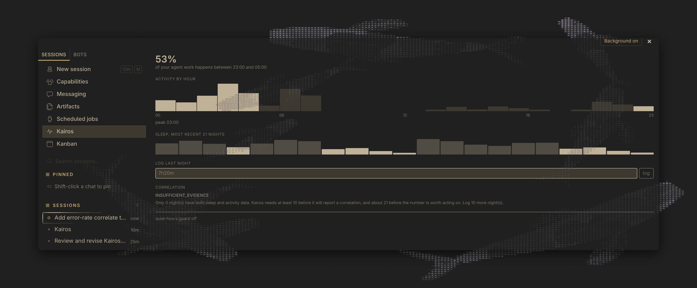
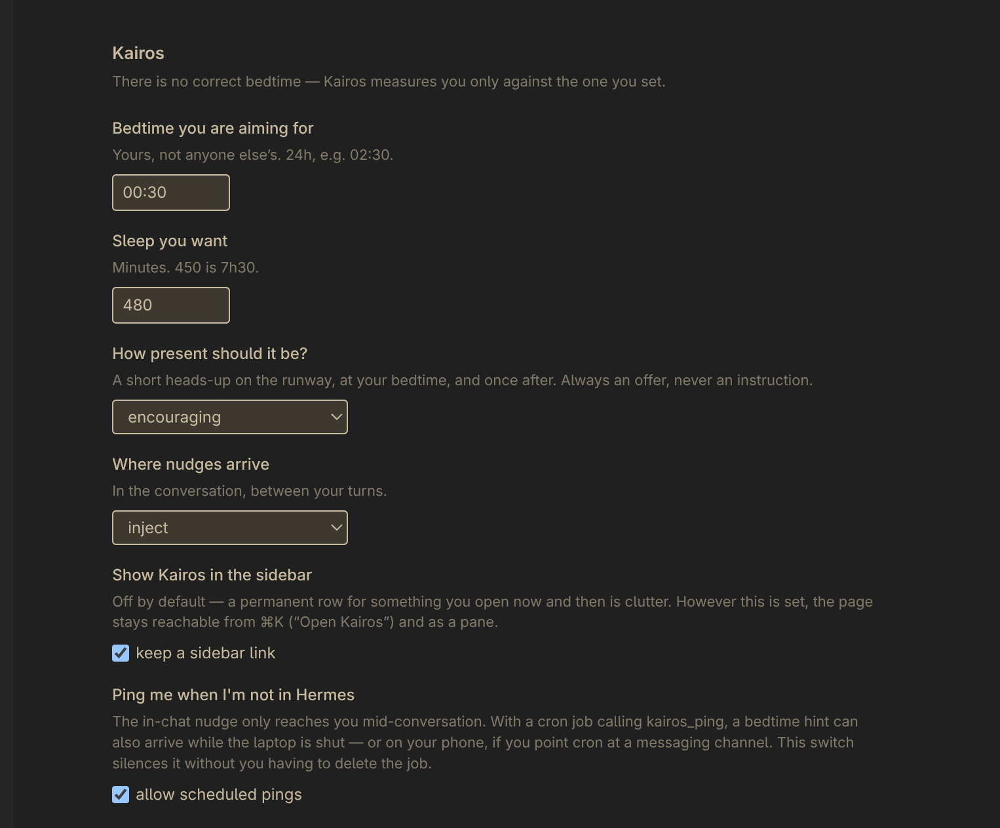
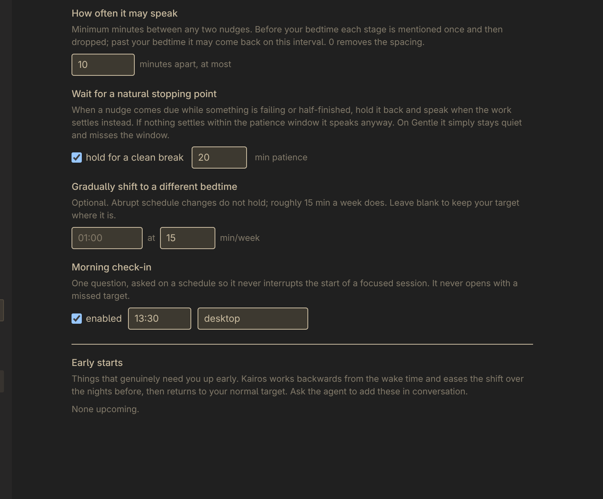

# Kairos

**Kairos knows when to interrupt you, and otherwise doesn't.**

It's a Hermes Agent plugin that reads your agent's own session history to find
the moments worth saying something at: a wind-down when you're at a natural
break rather than mid-thought, the note you left yourself last night handed
back when you return, a suggestion to step away when the work has stopped
moving forward. It reports whether your sleep affects your output only when
the sample actually supports it, and says nothing the rest of the time.

```
> ☾ ████████░░ · bedtime 02:30 · 22 min out
>
> Good spot — the last few calls all went through. If you want the
> full 7h30, this is an easy place to leave it. Want me to write up where
> we got to so you can start winding down?
>
> · say "not tonight" to mute
```

The bar fills with night as your bedtime gets closer, so you can read the
runway without reading a sentence. The flower only turns up on the last rung,
once the mark has already gone past. It stays meaningful by being rare.

## Why it's called Kairos

The Greeks had three words for time. Chronos is the clock: measured,
sequential, indifferent. Aion is the cycle, the year coming back around.
Kairos is the third one — the right moment, the narrow window where an action
lands instead of bouncing off. In the iconography he has wings on his feet and
a single lock of hair at the front of an otherwise bald head: you can catch
him on the way in, and once he has gone past there is nothing left to grab.

The clock knows what time it is and nothing else. It doesn't know whether
you're mid-thought or finished, whether the build is green, whether you'd
thank anyone at all for interrupting. This is named after the other one.

## It can tell whether you're at a clean break

A timer can't do this and neither can your watch. Kairos looks at whether the
work is actually at rest right now — whether the last few tool calls succeeded
or failed — then adapts instead of nagging.

If you're clear:

> *That's your bedtime, and you're at a natural break. I've got the thread —
> nothing's lost if you head to bed now.*

If you're mid-surgery:

> *That's your bedtime. Land whatever you're mid-way through and I'll note
> where we end up — it'll be waiting, with fresh eyes on it.*

Nobody stays up out of love for the bug. They stay up because stopping feels
like losing the thread. So Kairos writes the thread down: what was in flight,
where it stopped, the obvious next move. The moment passes whether or not you
were ready for it, which is a terrible property in a note-taking system, so
the file goes on disk.

## Two other moments it watches for

A bedtime is one opportune moment. The name implies the rest, and two more
are wired in. Both follow the same rules as the wind-down: they offer, they
end on a question, and they report what was observed rather than what it
concluded about you.

**The note you left yourself.** Kairos writes down where the work got to when
you stop. For a while nothing handed it back, which made the feature half of
a promise. Now the most recent note is offered once, on the first turn of a
later session, and then marked seen:

```
> ○  you left yourself a note last night
>
> Left the Gadgetbridge parser half-done: kind histogram works, night
> reassembly does not.
>
> · that's where we stopped. Pick it up, or say "fresh start".
```

It stays quiet if the note is older than 36 hours, if it has already been
handed back, or if it belongs to a session that never actually ended.

**The work has stopped moving.** Four or more failed tool calls inside 25
minutes, and at least half of recent calls failing, is a measurable fact
about the work. Going in circles happens at two in the afternoon as readily
as at two in the morning, and at two in the afternoon a bedtime has nothing
to do with it:

```
> ○  nothing to do with the hour — just the work
>
> 6 failed calls in a row here, mostly `terminal`.
>
> That is often the point where stepping away beats another attempt.
> I can write down where this got to, so picking it up is cheap.
> Want me to?
>
> · say "keep going" and I'll drop it
```

Note what it does not say. It does not say you are stuck, frustrated, tired,
or going round in circles — those are conclusions about a person drawn from a
number about some tool calls. It reports the count and makes an offer.

It is deliberately hard to trigger: a false positive interrupts someone who
is working fine, which is the exact failure this plugin exists to avoid. Six
calls minimum before it will judge a session at all, twice a night maximum,
ninety minutes between mentions, silent at tone `off` or when snoozed. And
it says nothing inside the wind-down's own window, so you are never handed
two different things to answer in one turn.

## Your agent was there

That last part is only possible because of where this runs. Anything else that
wants to know how your day went has to ask you, and you are a poor witness to
your own evening. Hermes was in the room, handing you the commands, and it has
timestamps on all of it.

It isn't a witness. It's an accessory. Kairos is what happens when the
accessory starts taking notes.

Here's real output from my machine, unedited, after four days of use:

```
  00:00 █████ 53
  02:00 ███ 35
  03:00 ███████████ 110
  04:00 ██████████████████████████ 244
  05:00 ████████ 77
  06:00 ████████████████████████████████████████ 371
  07:00 ███████████████████████ 217
  13:00 ▌ 6
  14:00 ██████ 58
  15:00 ██ 25
  16:00 ▌ 8
  23:00 ▌ 2
```

Ninety-two percent of it lands outside 08:00–22:00, and the peak hour is
06:00. There are no messages at all between 08:00 and 13:00, or after 17:00.
No watch, no subscription and no correlation coefficient required to find that
interesting.

Two honest caveats, since this is the number the whole plugin rests on. It is
**four days** of data — enough to see a shape, nowhere near enough for the
report to say anything, which is why `kairos_report` still returns
`INSUFFICIENT_EVIDENCE` on this machine. And the peak moved: it was 04:00 when
I started writing this, and 06:00 by the time I finished, because the thing
that pushed it later was building Kairos. The measurement perturbed the
measured. Both facts argue for the plugin rather than against it.

## There is no correct bedtime

Kairos has no opinion about when you sleep. It measures you against the
target you set, and until you set one it says nothing at all. Two things fall
out of that, and both are load-bearing.

It never decides you're tired. The hour on the clock tells you nothing about
anybody's body and the copy never pretends otherwise. You will not get a
single "you must be exhausted" out of this plugin.

Stopping mid-problem is not a failure either. Sleep does real consolidation
work, so handing something to tomorrow-you is a strategy rather than a
surrender, and Kairos is allowed to say so when it's past your mark and
you're still chewing.

## You pick how much it talks

Tone is one setting, in Settings → Plugins → Kairos. Nothing touches a tool call
below `firm`.

| Tone | What you get |
|---|---|
| `off` | Measurement only. Sleep never comes up. |
| `gentle` | One note near bedtime, and only if you're at a clean stopping point. |
| `encouraging` *(default)* | Runway, bedtime, and once after. Always phrased as an offer. |
| `firm` | Same, plus a confirmation step on destructive commands in quiet hours. |
| `guardian` | Same, and those commands can be refused outright. Entirely your call. |

Nudges land between your turns, never in the middle of a tool chain, as a
quoted block the agent reads out. Optionally a desktop notification goes with
it — the Desktop half posts that one, and only while Hermes is not the window
in front, so the quoted block is never skipped.

You set the spacing. A minimum gap (45 minutes by default, anywhere from 0 to
240) applies between any two nudges whatever the stage. Each stage before
your bedtime gets mentioned once and is then dropped, because "22 min out"
does not bear repeating. Only the past-your-bedtime message is allowed to
come back, on that same interval, and it comes back at most twice — shorter
each time, and the third one says it's the last.

It also tries to catch you at a sensible moment rather than cutting in. If a
nudge comes due while the recent tool calls are failing it waits, and
speaks when the work settles. That wait is bounded by a patience window (20
minutes by default) after which it speaks anyway, except on `gentle`, which
would rather miss the window than interrupt you. Turn the whole behaviour off
if you want it punctual instead of polite.

Say "not tonight" and it's gone without a word of argument, no second
attempt, nothing about it in the morning.

## Early starts, worked backwards

Tell it about plans with a time in them. It does the arithmetic, eases the
shift across the nights before, and then lets go.

> *Hiking trip Saturday, need to be up at 6:30.*

```
2026-11-11  bedtime 01:20   easing in
2026-11-12  bedtime 00:10   easing in
2026-11-13  bedtime 23:00   the night that counts
2026-11-14  bedtime 02:30   released, back to normal
```

It can also walk your usual target somewhere else over weeks. Yanking a sleep
schedule two hours in one night doesn't hold. Fifteen minutes a week does.

## One question in the morning

A scheduled job asks how you slept. That's the whole interaction.

It runs on cron rather than waiting for your first session, because when you
sit down with something specific in mind the last thing you want is a
wellness interview. And it never opens with your miss. Not "you were up till
four again." Patterns belong in the report, in aggregate, where they're
information instead of a telling-off.

## It would rather say nothing than lie

Most quantified-self software will cheerfully run a trend line through nine
data points.

- Under 10 matched nights you get `INSUFFICIENT_EVIDENCE` and no numbers at
  all, not even hedged ones
- Under 21 nights every figure is stamped `PROVISIONAL`
- Every correlation carries a bootstrap interval, corrected for the number of
  features tested at once (five, so each is a 99% interval); if that interval
  contains zero the answer is `INCONCLUSIVE` rather than a direction
- No causal verbs anywhere. "Associated with", never "causes"

Tested against synthetic nights with one real effect planted and four features
that are pure noise (`tests/test_analysis.py`). From 30 nights up it finds the
planted one every time and a report carries a spurious "associated with"
about one time in twenty; at 21 nights it's one in eleven, because the
bootstrap interval is optimistic on small samples, and the strong planted
effect is missed just under 1% of the time. The correction costs sensitivity:
a modest real effect takes more nights to clear the gate than it would
without it. Erring that way is the point.

It also won't dress a tautology up as a discovery. "Worked late" against
"slept less" is nearly circular, because if you were working at 3am you
weren't asleep at 3am. The number worth having is one that isn't:

**Spread beats earliness.** A reliable 02:00 does more for you than a 23:00
that swings by two hours, so the variance is the target rather than the mean.

## The one it reports without a coefficient

"Do I make more mistakes when I'm short on sleep" is the question people
actually want answered, and it is the one where this plugin is most likely to
lie to you. Kairos answers a narrower version of it, on purpose.

It shows the share of tool calls that **failed** on the day after each logged
night, split at your median night:

```
Failed tool calls the day after (observation, not a correlation):
  after shorter nights (mean 294 min, n=7): 11.4% of calls failed
  after longer nights  (mean 476 min, n=7): 6.2% of calls failed
```

Four things that number is not. It is **not a correlation** — no coefficient,
no interval, and it stays out of the corrected family above, so it costs the
five real features none of their sensitivity. It is **not mistakes** — the
failure test is a heuristic over result text, so deliberate probes, greps that
match nothing and expected non-zero exits all count. It is **not causal**, and
the arrow could as easily run backwards or through a hard day's work sitting
upstream of both. And it is **not built out of your history**: Hermes stores
no tool result text, so a day before Kairos was installed has an unknown
failure count, not a clean one. Those days are dropped rather than scored as
zero, which is why this takes weeks to say anything and says so plainly
meanwhile.

It needs 20 watched calls in a day before that day counts at all, and three
days either side of the median before it will compare them.

**Spread beats earliness** is still the number worth having. This one is an
observation you are free to ignore.

## Tools

| Tool | What it does |
|---|---|
| `kairos_goal` | Bedtime, duration, the slow-shift target, tone, check-in. |
| `kairos_commitment` | Early starts, worked backwards and eased in. |
| `kairos_winddown` | Nudge status, `snooze`, and the bedtime `handoff`. |
| `kairos_checkin` | The one morning question. |
| `sleep_log` | Log a night. Takes `7h20m`, `6.5h`, `7:20`, `400m`. |
| `sleep_import` | Import sleep — a Xiaomi/Mi Fitness export, a Gadgetbridge database, or any CSV. Format sniffed. `probe` shows what parsed and writes nothing. |
| `kairos_activity` | Your work pattern, out of Hermes's own history. Includes the failed-call rate after short nights. |
| `kairos_report` | The honest correlation. `format="text"` for the chart. |
| `kairos_guard` | Quiet-hours guard on destructive work. Off unless you say so. |
| `kairos_wearable` | Read sleep from a health MCP server you already run. |
| `kairos_ping` | For a cron job: is a nudge due right now, out of session? |

Three things happen without a tool call, from hooks rather than the toolset:
the wind-down arrives between turns, last session's note is handed back on the
way in, and a break gets offered when the work stops moving. Nothing to invoke
and nothing to remember — see [Disclosure](#disclosure) for every read.

## Where sleep comes from

Kairos does not care what's on your wrist, and it does not need one. You can
type a night in plain language (`"slept about six hours, woke up twice"`) and
that is a first-class path, not a fallback — the most reliable tracker is a
person saying "about five hours, badly".

If you do want a device in the loop, sleep arrives through one small interface
(`night, duration, wake_count?, quality?`) with four ways to fill it:

| Source | Reads | Supplies |
|---|---|---|
| `csv` | any tracker's export, or one you typed | wake count, quality |
| `xiaomi` | a Mi Fitness / Xiaomi account export | bedtime, wake time, wake count, sleep score, stages |
| `gadgetbridge` | a Gadgetbridge SQLite export | onset/offset times, wake count |
| `mcp` | a health MCP server you already run | onset/offset times, wake count, quality |

File sources open read-only, fail closed on anything that isn't a sleep
export, and never overwrite a night you logged yourself. `probe` shows what
parsed and writes nothing.

**Full setup, per device, plus what's verified and what isn't:
[docs/sleep-sources.md](docs/sleep-sources.md).**

## Being useful when you're not in a session

The in-session nudge rides `pre_llm_call`, which only reaches you while
you're actually talking to Hermes. That is the wrong assumption for a bedtime
hint: the most likely reason you're awake at 1am and not winding down is
that you stopped working an hour ago and picked up your phone.

So `kairos_ping` exists for a scheduled job to call. It evaluates exactly the
same gates — switched on, target set, tone, snooze, spacing, stage — and
returns `say_nothing: true` when nothing is due. Cron refuses to deliver an
empty payload, so silence costs nothing and you only hear from it when
there's something to say.

```bash
# the window around a 04:00 bedtime, checked every 20 minutes
hermes cron create "*/20 2-6 * * *" \
  "Call kairos_ping. If say_nothing is true, output nothing at all. \
   Otherwise deliver the nudge text verbatim and stop." \
  --name "Kairos evening ping" --deliver local --timezone America/Chicago
```

Checking often and speaking rarely is the point. On the author's machine that
schedule is fifteen evaluations a night and, at `gentle`, exactly one that
says anything:

```
02:00 .   02:20 .   02:40 .   03:00 .   03:20 SPEAK   03:40 .   04:00 .
04:20 .   04:40 .   05:00 .   05:20 .   05:40 .   06:00 .   06:20 .  06:40 .
```

Point `--deliver` at a messaging channel instead and the nudge arrives on your
phone rather than in a terminal you're not looking at.

### The honest limit: cron needs the machine awake

A cron job is evaluated by Hermes, on the machine Hermes runs on. If that is a
laptop and the lid is shut, nothing runs — no evaluation, no ping, and
`--deliver telegram` does not change that, because there is no process awake
to send it. This is worth being blunt about, since "it reaches you when you're
not at the keyboard" is the entire point of the feature and it has a hard
dependency the copy shouldn't hide.

Worse, a scheduler that catches up on missed jobs will fire the moment the
machine wakes. A bedtime hint delivered at 10am is not a late nudge, it is
nonsense:

```
⚠ catch-up after missed fire: scheduled 02:00, ran 16:24 (14h 24m late)
```

That one is from the author's own cron log. So the `past` rung is bounded at
three hours after your target: beyond that the night is over and Kairos has
nothing useful to say about it. A catch-up that lands the next morning
evaluates its gates, finds itself outside every rung, and returns
`say_nothing`. The stale nudge is dropped rather than delivered.

So pick the shape that matches your setup:

| Where you are | What reaches you |
|---|---|
| At the machine | The in-session nudge, on `pre_llm_call`. |
| Away from it, machine still on | The ping — and this is the case worth setting up. Point `--deliver` at a messaging channel and it finds you on your phone. It knows the time and your target, and admits it knows nothing about what you were doing. |
| Away from it, machine off | Nothing. Nothing informed is possible, and Kairos would rather be quiet than guess. |

The middle row is the one that matters. Being away from the keyboard is the
normal reason you're drifting past your bedtime, and it is fully covered as
long as the machine you work on is awake — because the thing talking to you is
the thing that watched you work.

For the third row, the honest answer is that a bare bedtime reminder is not
this plugin's job. Your phone already has an alarm, and it will do that one
better than a Hermes install with nothing to say.

**What won't work is a second install.** You could put Kairos on an always-on
box so the ping always fires, and it would — badly. Everything Kairos knows
lives in that machine's own `plugin-data/kairos/` and two instances share
nothing, but the state isn't really the problem. The problem is that an
instance on a server *wasn't in the room*.

It has no sessions to read, so `stop_state` comes back unobserved and the
nudge degrades to "it's past your mark" with nothing behind it. It has none of
your sleep history. Worst of all, the replies land in the wrong place: say
"not tonight" and you snooze the server's log while your laptop's is untouched
and still due, and ask it to write up where you got to and it has nothing to
write, because it never saw the work.

The ping is not a notification, it is the opening of a conversation, and the
conversation only works where the work happened. **So run it on the machine
you work on and deliver it anywhere you like.** That split is the useful one:
the knowing happens where the work is, the telling can reach your pocket.

Both delivery paths share a single `nudge_log`, so the spacing rule holds
across them: you will not get a scheduled ping and an in-chat nudge for the
same moment. The ping has its own switch in settings, so you can silence it
without going back to hunt down the cron job.

**Out of session it will not pretend to know what you're doing.** The
in-session copy can say "the last few calls all went through" because
it checked. The scheduled ping has nothing to check, and says so:

> *You'd set 02:30 as the mark. No pressure and no idea what you're up to —
> but if you're winding down anyway, this is me saying goodnight.*

A second job can pull last night off your watch each morning, so the
check-in has the number before it asks you anything:

```bash
hermes cron create "30 13 * * *" \
  "Call kairos_wearable action=sync, then kairos_checkin action=ask." \
  --name "Kairos morning check-in" --deliver local \
  --timezone America/Chicago --skill kairos:kairos-coaching
```

## The desktop half

One package, both SDKs. A right-hand pane and a `/kairos` page with the live
histogram, a 21-night sleep track, an inline log box and the current verdict,
plus a `☾` chip in the status bar, a ⌘K command, and a settings page. Off
until you enable it in Capabilities → Plugins.






Reach the page with ⌘K → **Open Kairos**, or turn on a sidebar link in
settings. That link is **off by default**: a permanent row for something you
open now and then is clutter, and the page is reachable without it.

It stays inside the plugin SDK surface: no prototype patching, no `eval`, no
querying the app's own markup, no DOM observers. Everything arrives through
this package's own backend namespace, and if the Python half is switched off
the pane says so instead of exploding.

## Install

<a href="hermes://plugin/install?repo=Gens-ai/Kairos&enable=1">Install in Hermes</a>

```bash
hermes plugins install Gens-ai/Kairos
hermes plugins enable kairos
```

Then talk to it like a person. *"I want to be in bed by 2:30, aiming for
seven and a half hours"* sets the target. *"Slept about five hours, woke up
twice"* logs the night. *"Flight at 7 on Saturday"* reshapes the week and
then puts it back.

## Disclosure

- **Reads** `state.db`, Hermes's own session store, read-only via `mode=ro`,
  inside the active profile's home. Message timestamps, roles and tool names
  only. **Never message content.** If the file is missing or unreadable it
  degrades to empty rather than failing.
- **Writes** only inside `<hermes home>/plugin-data/kairos/`: a SQLite
  database through the sanctioned `plugin_db()` helper, plus the handoff notes
  you asked for.
- **Reads sleep files you point it at**, read-only: a CSV; a Mi Fitness
  export folder, in which it looks only for the two
  `hlth_center_*fitness_data.csv` tables; or a Gadgetbridge SQLite export
  opened with `mode=ro`. Nothing is written back to any of them, and
  an import never overwrites a night you logged yourself. It **fails closed on
  anything that isn't a sleep export** and echoes none of its contents, so the
  importer cannot be used as a general file reader; a SQLite file without a
  Gadgetbridge sample table is refused without its schema being listed. The
  table name is validated against the database's own catalogue before it
  reaches a query, and kind filters are bound parameters.
- **No network calls of its own.** No telemetry, no credentials read, stored
  or requested, no self-updater. The one outbound path is `ctx.call_mcp` to a
  health MCP server, which does nothing until the operator names that server
  in `plugins.entries.kairos.mcp_allowlist`. Kairos never sees that server's
  credentials, and a server it has not been granted raises `PermissionError`
  with the exact config key to set. Imported rows are tagged `mcp:<server>`;
  anything you logged yourself is never overwritten.
- **`kairos_ping`** reads the clock and the gates and returns text. It sends
  nothing itself — delivery is whatever cron job you chose to create, under
  your own schedule and channel.
- **Backend routes** (`dashboard/plugin_api.py`) mount at
  `/api/plugins/kairos/` and run in the gateway process. `GET /summary`,
  `/goals` and `/winddown` are reads; `POST /sleep`, `/goals`, `/commitments`
  and `/guard` are writes. They import nothing but this package's own modules.
- **Desktop half** imports only `@hermes/plugin-sdk`, `react` and
  `react/jsx-runtime`. It reads through `ctx.rest` and contributes a pane, a
  route, a status chip, a palette command, a settings page, and — only if you
  switch it on — one sidebar row. The sidebar preference is the single thing
  it stores locally, under its own `ctx.storage` namespace; everything else
  lives in the plugin's own database.
- **The `pre_llm_call` hook** injects context between turns, at most one
  block per turn, and only on the paths listed here: the wind-down block
  (silent when no target is set, at tone `off`, when that rung already fired
  tonight, or when you've snoozed); the handoff note you saved, once, on the
  first turn of a later session; and a break suggestion when the recent tool
  results it watched are failing. Stopping-point detection reads nothing but
  those tool outcomes — no files, no git, no shell.
- **Desktop notification**, only if you set delivery to `both`: the hook
  broadcasts a `plugin.kairos.nudge.due` event carrying the night, the rung
  and your bedtime string, and the Desktop half turns it into one OS
  notification through the SDK's `ctx.os.notify`. The SDK shows it only
  while Hermes is not the window in front, and it is subject to the app's
  own plugin-notification setting. Nothing fires without the Desktop.
- **No shell commands.** Kairos never spawns a process.
- **The guard** can escalate or veto a tool call, but only once you enable
  it, only at tone `firm` or `guardian`, only for `terminal`, `write_file`,
  `patch`, `execute_code`, `browser_exec` and `delegate_task`, only inside
  the window you set, and only on destructive argument patterns (`rm -rf`,
  `git push --force`, `git reset --hard`, `DROP TABLE`, `DELETE FROM`,
  `truncate`, `migrate`, `deploy`).
  It fails open: any internal error lets the call through rather than wedging
  your agent.
- **The morning check-in** is a Hermes cron job you create, delivered where
  you choose. Off by default.
- Correlations here are observational and single-subject. This is not medical
  advice and Kairos diagnoses nothing. If something clinical is going on, see
  an actual doctor rather than a plugin named after a Greek god.

MIT.
